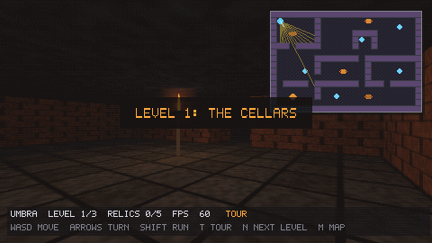
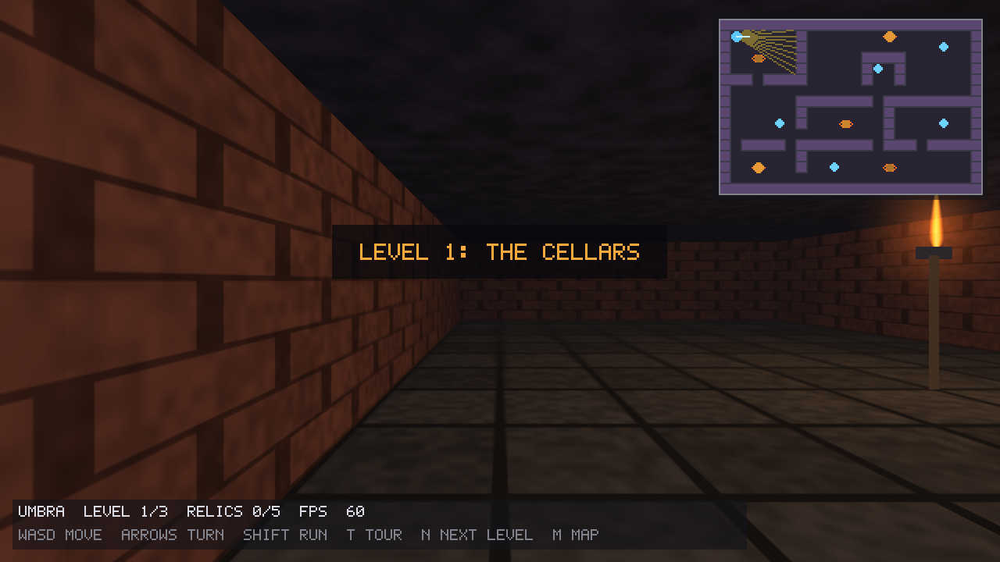
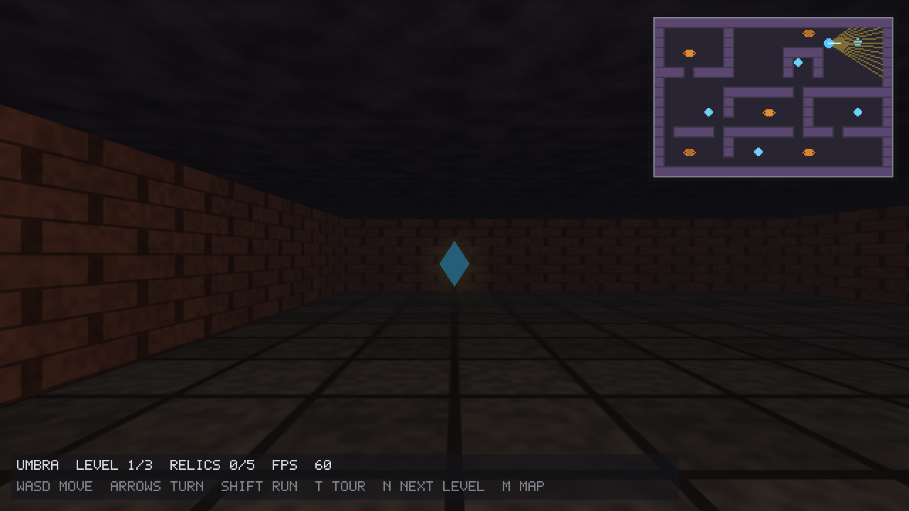
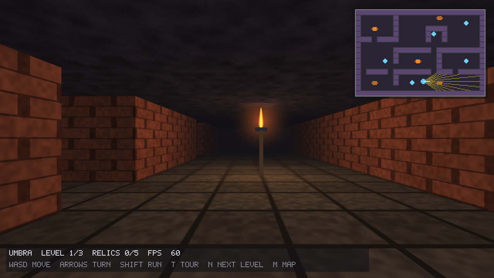
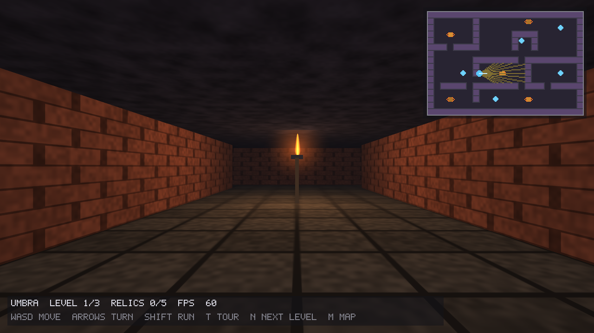
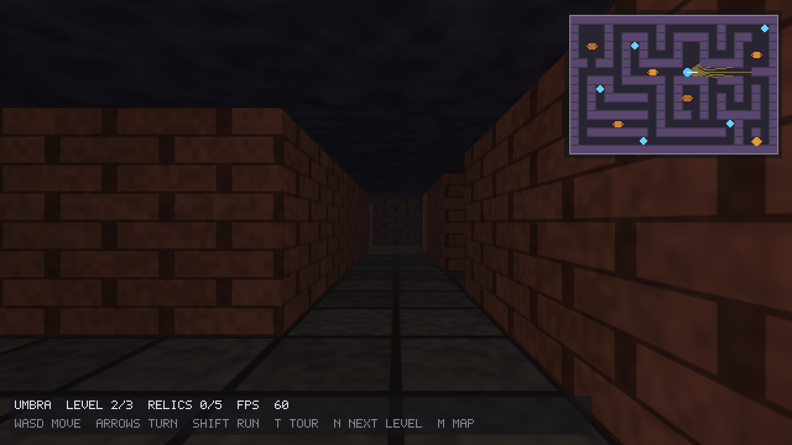
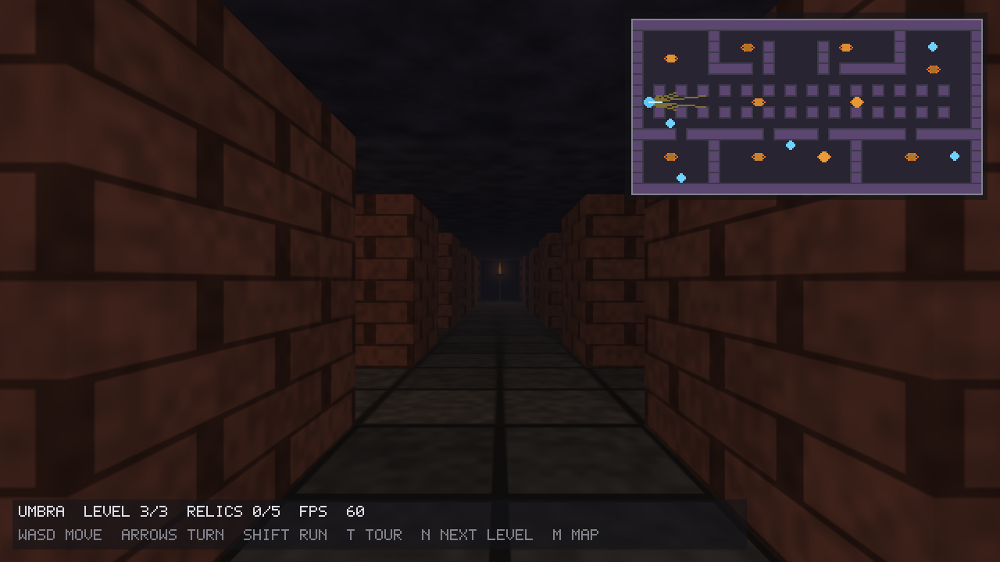

# UMBRA

A real-time first-person dungeon game for ICS 3204 (Computer Graphics). You explore three dungeon levels of brick corridors and rooms lit by flickering torches, with a minimap in the corner. Each level hides five glowing relics: find them all to reach the next level, and clear all three to escape.

UMBRA was built in three stages. CP1 implemented the core 2D graphics techniques in pure C++. CP2 added transformations, animation and a raycast first-person view, still in pure C++. The **final version** is a real 3D OpenGL application: the level is built as textured 3D geometry, lit by the torches in shaders, and you control it live with the keyboard.



## Group Members and Responsibilities

| Member | ID | Responsibility | CP1 contribution | CP2 contribution |
|---|---|---|---|---|
| Arthur Asava | 156972 | Team lead, raycasting and algorithm implementation | DDA grid raycasting (`raycast`) | First-person renderer, walkthrough and hall demo (`view3d`, `demo_walkthrough`, `demo_hall`) |
| Nelly Nkatha | 160761 | Map and minimap design, repository management | Grid map, level loader and clipped minimap (`map`) | GIF writer, bitmap text and the animated minimap (`gif`, `text`, `demo_minimap_tour`) |
| Ravine Riang'a | 168669 | Animation | Torch flicker curve (`flicker`) | Easing, keyframes and path following (`animation`, `tour`, `demo_animation`) |
| Shawn Owiro | 152066 | Graphics effects | Colour blending and distance fog (`shading`) | Torch sprites with depth hiding (`sprite`, `demo_sprites`) |
| Darrel Kariuki | 157769 | Interface and application development | 2D transforms, player and collision (`transform`, `player`) | Matrix transformations (`matrix`, `demo_transforms`) |
| Anita Bichanga | 167752 | Testing and documentation | Test suite, README, evidence (`tests`) | CP2 tests, documentation and evidence (`test_cp2`, `docs/`) |

The OpenGL final version (`game/`, `mat4`, `level_mesh`, `texture_gen`, `test_final`) brings every module above into one live application. The line, polygon, circle/ellipse and curve modules were written as a shared foundation for the whole group.

## Playing the Final Version

| Key | Action |
|---|---|
| W / S or Up / Down | Move forward and back |
| A / D | Step sideways |
| Left / Right (or Q / E) | Turn |
| Shift | Run |
| T | Start or stop the guided tour of level 1 (the camera follows a smooth route on its own) |
| N | Skip to the next level |
| M | Show or hide the minimap |
| F12 | Save a screenshot to `output/` |
| Esc | Quit |

Walk into a glowing blue relic to collect it. The counter at the bottom left shows how many you have found, and the minimap marks the ones still waiting. When a level's five relics are found, the next level loads.

| Level | Name | Layout |
|---|---|---|
| 1 | The Cellars | Rooms joined by a long corridor |
| 2 | The Crypt | A maze of narrow passages |
| 3 | The Great Hall | A wide pillared hall with side chambers |

Levels are plain text files in `levels/`: `#` wall, `.` floor, `P` player start, `T` torch, `R` relic.

## Technologies / Tools

- C++17
- OpenGL 3.3 core profile with GLSL shaders
- GLFW 3.4 for the window and keyboard (downloaded automatically by CMake the first time you configure)
- glad as the OpenGL function loader (generated code in `external/glad`)
- CMake 3.16+ for the build and CTest for the tests
- Git and GitHub for version control, issues and pull requests

The CP1 and CP2 demos still use no library at all: they write PPM images and GIF animations with our own code.

## Graphics Techniques / Algorithms Implemented

### Final version (OpenGL)

| Technique | Implementation | File |
|---|---|---|
| OpenGL pipeline | Vertex buffers and vertex arrays, vertex and fragment shaders, depth testing, multisampling | `game/renderer.cpp` |
| 3D objects | The grid map turned into wall, floor and ceiling quads with normals and texture coordinates; relics as octahedra | `src/level_mesh.cpp`, `game/renderer.cpp` |
| 3D transformations | 4x4 model, view (`lookAt`) and perspective projection matrices, written by us | `src/mat4.cpp` |
| Lighting and shading | Per-pixel Lambert lighting from up to 32 torch point lights with distance falloff, plus a dim lantern at the player | `game/renderer.cpp` (world shader) |
| Light occlusion | Each face stores which torches can see it, found with DDA rays when the level loads, so light never passes through walls | `src/level_mesh.cpp` |
| Texture mapping | Procedural brick, stone floor and ceiling textures, tiled with repeat wrapping and mipmaps | `src/texture_gen.cpp` |
| Fog | Smoothstep distance fog in the fragment shader | `game/renderer.cpp` |
| Billboards and blending | Torch poles, flames and glows as camera-facing quads; additive blending for light | `game/renderer.cpp` |
| Animation in OpenGL | Torch flicker drives light and flame size, relics spin and bob (model matrix per frame), head bob, the guided tour along a spline | `game/main.cpp`, `game/renderer.cpp` |
| 2D overlay | Minimap and HUD built with the CP1 polygon, line and text code, uploaded as textures each frame, drawn with an orthographic projection | `game/hud.cpp` |

### CP1 and CP2 (pure C++)

| Topic | Implementation | File |
|---|---|---|
| Line drawing and operations | DDA and Bresenham lines | `src/line.cpp` |
| Polygon representation and operations | Vertex-list polygon, signed area, centroid | `src/polygon.cpp` |
| Polygon clipping and filling | Sutherland-Hodgman clipping, scanline (parity) fill | `src/polygon.cpp` |
| Circle and ellipse representation | Midpoint circle (outline and filled), midpoint ellipse | `src/circle_ellipse.cpp` |
| Curves | Cubic Bezier, Catmull-Rom spline | `src/curves.cpp` |
| Raycasting | Grid DDA ray stepping with fisheye correction | `src/raycast.cpp` |
| Map and minimap | Level parser, run-length merging of cells into polygons, clipped scrolling minimap | `src/map.cpp` |
| Colour | Linear RGB blending, smoothstep distance fog | `src/shading.cpp` |
| 2D transformations | Translate, rotate about a pivot, scale; then 3x3 matrices with shear, reflect, compose and invert | `src/transform.cpp`, `src/matrix.cpp` |
| Animation | Bezier torch flicker, easing, keyframe tracks, arc-length path following | `src/flicker.cpp`, `src/animation.cpp` |
| Sprites | Camera-space projection, per-column hiding behind walls | `src/sprite.cpp` |
| First-person view (software) | Brick pattern, fog, torch light with shadow rays, head bob | `src/view3d.cpp` |
| GIF output | Median-cut palette, ordered dithering, LZW compression | `src/gif.cpp` |
| Player | Turning, movement and sliding wall collision | `src/player.cpp` |

A table with the full answer for each technique (what, how, where it is used, what it achieves) is in [docs/TECHNIQUES.md](docs/TECHNIQUES.md).

## How to Compile and Run

```bash
cmake -S . -B build -DCMAKE_BUILD_TYPE=Release
cmake --build build -j4

# run from the repository folder so levels/ and output/ are found
./build/umbra_game              # the OpenGL game
./build/umbra_game --tour       # start in guided-tour mode
./build/umbra_game --start-level 2

# automated tests
ctest --test-dir build --output-on-failure
```

**Windows with Visual Studio:** open the **Developer PowerShell for VS**, `cd` into the repository and run:

```
cmake -S . -B build
cmake --build build --config Release
.\build\Release\umbra_game.exe
ctest --test-dir build -C Release
```

The first `cmake -S . -B build` downloads GLFW from GitHub, so it needs an internet connection and Git. Later builds work offline. The game needs a graphics driver with OpenGL 3.3, which almost every PC from the last ten years has.

To build only the pure C++ parts (no window, no download): `cmake -S . -B build -DUMBRA_BUILD_GAME=OFF`.

**Command-line options** (for screenshots and recordings): `--start-level <n>` begins on level n, `--level <file>` plays a single custom level file, `--at <x> <y> <degrees>` starts at a map position, `--size <w> <h>` sets the window size, and `--frames <n>` runs a fixed number of frames then exits, with `--screenshot <file.ppm>` or `--record <file.gif>` to save the result.

### The CP1 and CP2 demos

Each demo writes into `output/`. Screenshots (PNG) are in `docs/screenshots/` and animations in `docs/media/`.

| Demo | What it shows |
|---|---|
| `demo_line` | DDA and Bresenham ray fans across a grid |
| `demo_polygon` | Rooms clipped against a viewport and filled |
| `demo_circle_ellipse` | Torches, player marker, sprite billboards, round room |
| `demo_curves` | Bezier flicker curve and a Catmull-Rom corridor spline |
| `demo_minimap` | A combined minimap using all the techniques above |
| `demo_map` | Level loaded from `levels/level1.txt`, full and player-following minimaps |
| `demo_raycast` | DDA rays on the minimap and the resulting first-person wall strips |
| `demo_flicker` | 12 torch flicker frames and the Bezier brightness curve |
| `demo_shading` | Corridor with and without distance fog, and the fog ramp |
| `demo_player` | Collision trail through the level and rotation about a pivot |
| `demo_transforms` | Translate, rotate, scale, shear, reflect, order of operations, inverse and composition |
| `demo_animation` | Six easing curves, motion strips and equal-distance path following |
| `demo_minimap_tour` | A player steers through the level while the minimap follows (GIF) |
| `demo_sprites` | Torches projected into camera space, hidden behind a pillar (GIF) |
| `demo_hall` | Torch approach and pillar sidestep in the software renderer (GIF) |
| `demo_walkthrough` | The software first-person walk through the dungeon (GIF) |

## Screenshots

| | |
|---|---|
|  |  |
|  |  |
|  |  |

## Current Progress

- The game is complete and playable: three levels, a live OpenGL window, keyboard movement with wall collision, textured walls, floors and ceilings, torch lighting with flicker, fog, torch sprites, collectable relics, a minimap and a HUD, and a guided tour mode.
- All CP1 and CP2 techniques are implemented in pure C++ with 16 demo programs.
- Three automated test programs (CP1, CP2 and the final version) run with `ctest`, all passing.

## Known Limitations / Issues

- Torch light is blocked per face, not per pixel: a face is either lit by a torch or not, so there are no soft shadow edges.
- Textures are generated by code; there is no loading of image files.
- The guided tour follows a route drawn for level 1.
- There is no sound, and no mouse look (turning is on the keyboard).
- The game needs OpenGL 3.3. On very old or virtual machines without it, the window will not open and the game says so.
- `clipSutherlandHodgman` assumes a convex clip window and `fillPolygonScanline` assumes a simple polygon.
- Wall collision uses the player's bounding circle, so it is slightly conservative at corners.
