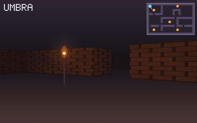
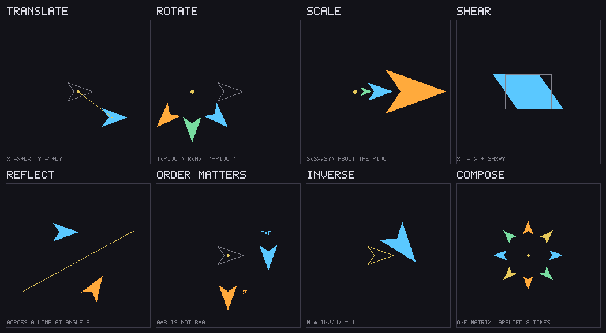
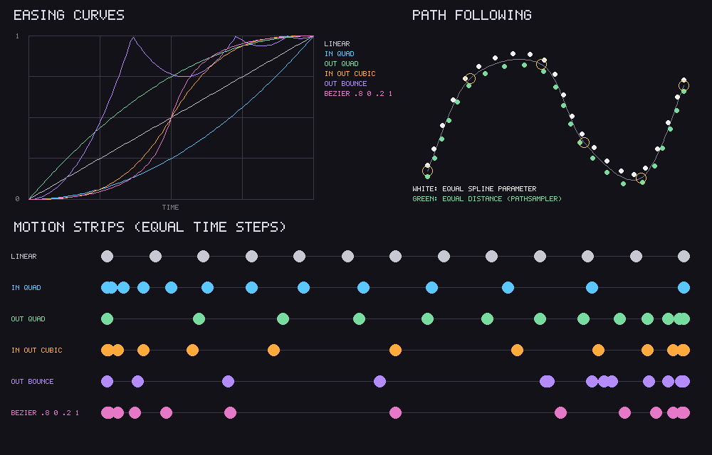
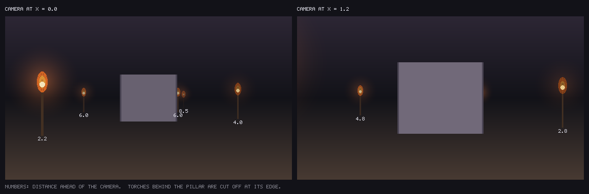
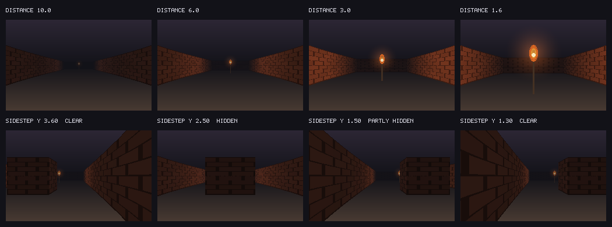
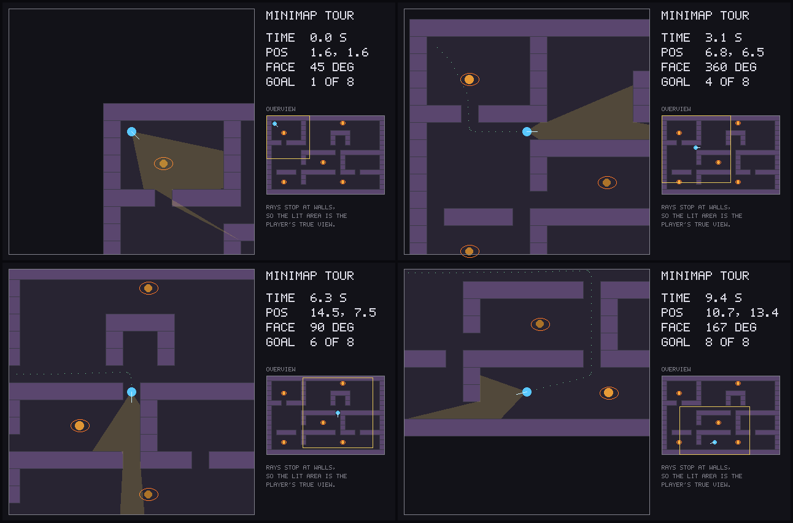
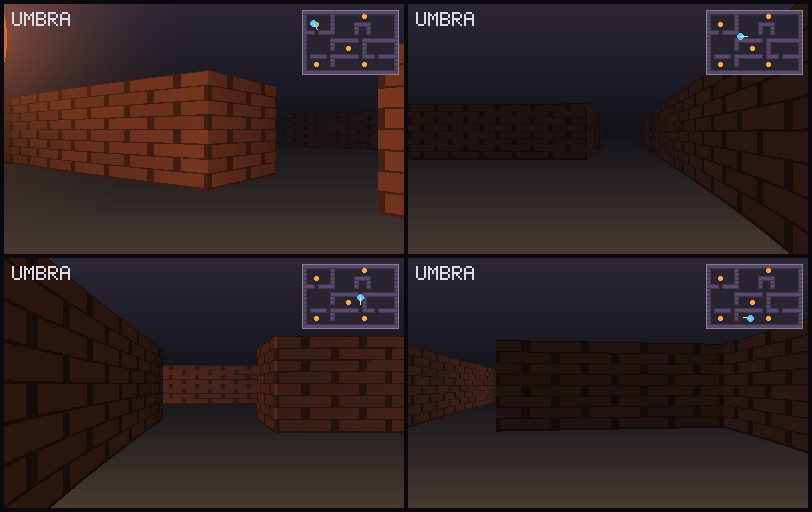

# UMBRA

A real-time raycasting dungeon engine for ICS 3204 (Computer Graphics). UMBRA renders a 2D grid-based dungeon in pseudo-3D using DDA raycasting, in the spirit of classic engines like Wolfenstein 3D: the player walks through corridors and rooms, walls darken with distance, torches flicker and light the bricks around them, and a 2D top-down minimap shows the level.

CP1 (Technical Foundation) implemented the core graphics techniques in pure C++. CP2 (Transformation and Animation) adds matrix transformations, an animation system and a first-person walkthrough, still in pure C++ and still writing images rather than opening a window. OpenGL and live keyboard control are planned for CP3.



## Group Members and Responsibilities

| Member | ID | Responsibility | CP1 contribution | CP2 contribution |
|---|---|---|---|---|
| Arthur Asava | 156972 | Team lead, raycasting and algorithm implementation | DDA grid raycasting (`raycast`) | First-person renderer, walkthrough and hall demo (`view3d`, `demo_walkthrough`, `demo_hall`) |
| Nelly Nkatha | 160761 | Map and minimap design, repository management | Grid map, level loader and clipped minimap (`map`) | GIF writer, bitmap text and the animated minimap (`gif`, `text`, `demo_minimap_tour`) |
| Ravine Riang'a | 168669 | Animation | Torch flicker curve (`flicker`) | Easing, keyframes and path following (`animation`, `tour`, `demo_animation`) |
| Shawn Owiro | 152066 | Graphics effects | Colour blending and distance fog (`shading`) | Torch sprites with depth hiding (`sprite`, `demo_sprites`) |
| Darrel Kariuki | 157769 | Interface and application development | 2D transforms, player and collision (`transform`, `player`) | Matrix transformations (`matrix`, `demo_transforms`) |
| Anita Bichanga | 167752 | Testing and documentation | Test suite, README, evidence (`tests`) | CP2 tests, documentation and evidence (`test_cp2`, `docs/`) |

The line, polygon, circle/ellipse and curve modules and the first five demos were written as a shared foundation for the whole group.

## Technologies / Tools

- C++17, standard library only (no graphics library or API yet)
- CMake 3.16+ for the build and CTest for the tests
- Output is written as PPM (P6) images and animated GIFs. Both writers are our own code, so nothing outside the standard library is needed.
- Git and GitHub for version control, issues and pull requests
- OpenGL and GLFW are planned for CP3

## Graphics Techniques / Algorithms Implemented So Far

| Topic | Implementation | File |
|---|---|---|
| Line drawing and operations | DDA and Bresenham lines | `src/line.cpp` |
| Polygon representation and operations | Vertex-list polygon, signed area, centroid | `src/polygon.cpp` |
| Polygon clipping and filling | Sutherland-Hodgman clipping, scanline (parity) fill | `src/polygon.cpp` |
| Circle and ellipse representation | Midpoint circle (outline and filled), midpoint ellipse | `src/circle_ellipse.cpp` |
| Curves | Cubic Bezier, Catmull-Rom spline | `src/curves.cpp` |
| Raycasting | Grid DDA ray stepping with fisheye correction | `src/raycast.cpp` |
| Map and minimap | Level parser, run-length merging of cells into polygons, clipped scrolling minimap | `src/map.cpp` |
| Colour | Linear RGB blending, smoothstep distance fog | `src/shading.cpp` |
| 2D transformations (CP1) | Translate, rotate about a pivot, scale | `src/transform.cpp` |
| **Matrix transformations (CP2)** | 3x3 homogeneous matrices: translate, rotate, scale, shear, reflect, compose, invert | `src/matrix.cpp` |
| **Animation (CP2)** | Easing curves (including a Bezier ease), keyframe tracks, arc-length path following, shortest-arc angle blending | `src/animation.cpp` |
| **Sprites (CP2)** | Camera-space projection with a rotation matrix, per-column hiding behind walls, flame drawn with midpoint circles and ellipses | `src/sprite.cpp` |
| **First-person view (CP2)** | Brick pattern, fog, torch light with shadow rays, head bob | `src/view3d.cpp` |
| **GIF output (CP2)** | Median-cut palette, ordered dithering, LZW compression | `src/gif.cpp` |
| Player | Turning, movement and sliding wall collision | `src/player.cpp` |
| Animation curve | Bezier brightness envelope for torch flicker | `src/flicker.cpp` |

A table with the full answer for each technique (what, how, where it is used, what it achieves) is in [docs/TECHNIQUES.md](docs/TECHNIQUES.md).

### How these map onto UMBRA

| Technique | UMBRA component |
|---|---|
| DDA / Bresenham lines | Per-column ray stepping through the grid, wall strips, minimap rays |
| Polygon clip and fill | Minimap rooms and walls, the player's lit field of view |
| Midpoint circle and ellipse | Torch flames, player marker |
| Bezier and Catmull-Rom | Torch flicker brightness, the camera's route through the level |
| Colour blending | Distance fog, torch glow |
| Matrix transformations | Camera-space sprite placement, player marker and view cone on the minimap |
| Easing and keyframes | Walking speed (ease in, cruise, ease out), smooth turns, head bob |

## Demo Programs

Each demo writes into `output/`. Screenshots (PNG) are in `docs/screenshots/` and animations in `docs/media/`.

| Demo | What it shows |
|---|---|
| `demo_line` | DDA and Bresenham ray fans across a grid |
| `demo_polygon` | Rooms clipped against a viewport and filled |
| `demo_circle_ellipse` | Torches, player marker, sprite billboards, round room |
| `demo_curves` | Bezier flicker curve and a Catmull-Rom corridor spline |
| `demo_minimap` | A combined minimap using all the techniques above |
| `demo_map` | Level loaded from `levels/level1.txt`, full and player-following minimaps |
| `demo_raycast` | DDA rays on the minimap and the resulting first-person wall strips |
| `demo_flicker` | 12 torch flicker frames and the Bezier brightness curve |
| `demo_shading` | Corridor with and without distance fog, and the fog ramp |
| `demo_player` | Collision trail through the level and rotation about a pivot |
| `demo_transforms` | Translate, rotate, scale, shear, reflect, order of operations, inverse and composition |
| `demo_animation` | Six easing curves, motion strips, and equal-distance path following; plus an easing race GIF |
| `demo_minimap_tour` | A player steers through the level, the minimap scrolls and the lit field of view follows (GIF) |
| `demo_sprites` | Torches projected into camera space: size and fog by distance, hidden behind a pillar (picture and GIF) |
| `demo_hall` | The same effects in the real renderer: a torch approached down a hall, and a pillar that hides it as the camera sidesteps (picture and GIF) |
| `demo_walkthrough` | The full first-person walk through the dungeon with torch light and head bob (GIF) |

### CP2 results













## How to Compile and Run

```bash
cmake -S . -B build -DCMAKE_BUILD_TYPE=Release
cmake --build build -j4

# run from the repository root so the output/ and levels/ paths resolve
./build/demo_walkthrough
./build/demo_transforms
./build/demo_animation
./build/demo_sprites
./build/demo_hall
./build/demo_minimap_tour
# (the CP1 demos are demo_line, demo_polygon, demo_circle_ellipse, demo_curves,
#  demo_minimap, demo_map, demo_raycast, demo_flicker, demo_shading and demo_player)

# automated tests
ctest --test-dir build --output-on-failure
```

On Windows with Visual Studio, build with `cmake --build build --config Release`, run `ctest --test-dir build -C Release` and find the programs in `build\Release\`. New `.cpp` files in `src/` and `tests/` are picked up automatically; re-run the first command after adding one.

`.gif` files open in any browser. `.ppm` files open in IrfanView or GIMP, or convert them with `magick input.ppm output.png`.

## Current Progress

- All CP1 techniques (lines, polygons, clipping and filling, circles and ellipses, curves) implemented in pure C++
- CP2: matrix transformations, easing and keyframes, path following, torch sprites and a lit first-person view with a walkthrough animation
- Sixteen demo programs and two automated test programs, all passing
- Everything runs without any library, and the animations are written as GIFs by our own encoder

Not yet started: a live window with keyboard control, real image textures, a heads-up display and anything that needs OpenGL. These are planned for CP3 (OpenGL integration) and the final.

## Known Limitations / Issues

- Rendering is still to images and GIFs, not a live window. There is no real-time input yet, so the walkthrough follows a fixed route.
- Walls use a generated brick pattern, not loaded image textures. Floor and ceiling are flat gradients.
- Torch light on walls is computed per screen column with shadow rays. It is accurate but not fast, so the walkthrough is rendered ahead of time rather than in real time.
- The GIF format limits each animation to 256 colours. Dithering hides most banding in the fog, but a little remains.
- `clipSutherlandHodgman` assumes a convex clip window and `fillPolygonScanline` assumes a simple polygon.
- Wall collision uses the player's bounding circle, so it is slightly conservative at corners.
- All demos use one hand-made level (`levels/level1.txt`), plus two tiny test halls inside `demo_hall`.
